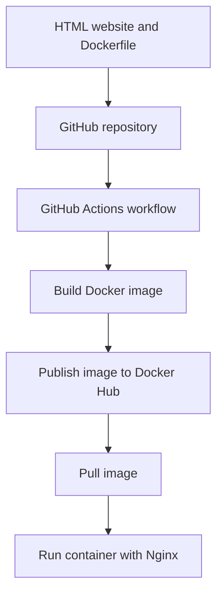

# Dockerized Website with Automated CI/CD

A beginner-friendly DevOps project that packages a static HTML website with Nginx, builds a Docker image, and automatically publishes that image to Docker Hub using GitHub Actions.

## Project overview

This project demonstrates a simple container delivery workflow:



## Tools and technologies

- **HTML** — static website content
- **Nginx** — web server inside the container
- **Docker** — image building and container runtime
- **Git and GitHub** — source control and code hosting
- **GitHub Actions** — automated build and image publishing
- **Docker Hub** — container image registry

## Repository structure

```text
docker-first-website/
├── .github/
│   └── workflows/
│       └── docker-build.yml
├── Dockerfile
└── index.html
```

## Run the website locally

### 1. Clone the repository

```bash
git clone https://github.com/PubeshKumar03/docker-first-website.git
cd docker-first-website
```

### 2. Build the Docker image

```bash
docker build -t my-first-website .
```

### 3. Run the container

```bash
docker run -d -p 8080:80 --name my-website my-first-website
```

Open [http://localhost:8080](http://localhost:8080) in your browser.

### 4. Stop and remove the container

```bash
docker stop my-website
docker rm my-website
```

## Pull and run the published Docker Hub image

The image is published at:

**Docker Hub:** https://hub.docker.com/r/pubeshkumar/my-first-website

Pull the latest image:

```bash
docker pull pubeshkumar/my-first-website:latest
```

Run it on port 8081:

```bash
docker run -d -p 8081:80 --name dockerhub-test pubeshkumar/my-first-website:latest
```

Open [http://localhost:8081](http://localhost:8081).

To stop and remove this test container:

```bash
docker stop dockerhub-test
docker rm dockerhub-test
```

## CI/CD workflow

The workflow is defined in `.github/workflows/docker-build.yml`.

When code is pushed to the `main` branch, GitHub Actions:

1. Checks out the repository.
2. Logs in to Docker Hub using repository secrets.
3. Builds the Docker image using the Dockerfile.
4. Pushes the image tagged `pubeshkumar/my-first-website:latest` to Docker Hub.

The workflow uses these GitHub repository secrets:

| Secret name | Purpose |
|---|---|
| `DOCKERHUB_USERNAME` | Docker Hub username |
| `DOCKERHUB_TOKEN` | Docker Hub access token with repository read/write permission |

Add them under **Repository Settings → Secrets and variables → Actions**. Never commit access tokens or passwords to the repository.

## What I practised

- Running Linux in a Docker container
- Writing a Dockerfile
- Building and running a containerized Nginx website
- Using Git to track project changes
- Creating a GitHub Actions workflow
- Storing credentials securely with GitHub repository secrets
- Publishing an image to Docker Hub
- Pulling and running the published image

## Project links

- **GitHub repository:** https://github.com/PubeshKumar03/docker-first-website
- **Docker Hub image:** https://hub.docker.com/r/pubeshkumar/my-first-website
- **GitHub Actions:** https://github.com/PubeshKumar03/docker-first-website/actions

## Notes

This is a learning project that builds and publishes a Docker image and demonstrates running it locally. It does not currently deploy the application to a cloud server or configure production infrastructure.
